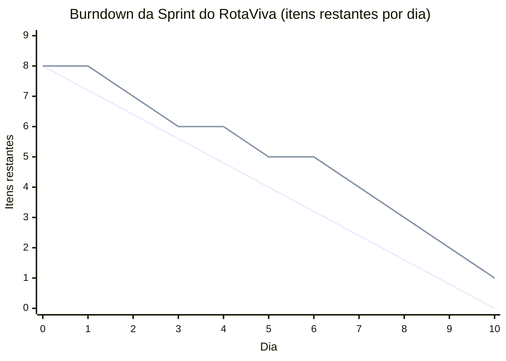

# Exercício 2: Gráfico Burndown da Sprint

## Dados de progresso diário (Sprint de dez dias úteis, oito itens)

A linha ideal parte de 8 itens no dia 0 e cai linearmente até 0 no dia 10, ou seja, uma redução de 0,8 item por dia. O progresso real foi: dia 0 com 8, dia 1 com 8, dia 2 com 7, dia 3 com 6, dia 4 com 6, dia 5 com 5, dia 6 com 5, dia 7 com 4, dia 8 com 3, dia 9 com 2, dia 10 com 1. A Sprint terminou com 1 item não concluído.

## Gráfico Burndown (Mermaid)

## Ponto de desvio identificado

O desvio principal aparece entre o dia 0 e o dia 2, quando a linha real fica acima da ideal: no dia 1 o time ainda tinha 8 itens, enquanto o ideal era 7,2, e no dia 2 tinha 7, enquanto o ideal era 6,4. Esse desvio indica que a squad começou a Sprint sem reduzir o trabalho pendente nos primeiros dias, provavelmente porque os itens não estavam suficientemente refinados ou porque houve dependência externa segurando o início. Há um segundo desvio entre o dia 5 e o dia 6, em que o real fica em 5 nos dois dias, ou seja, nenhum item foi concluído em um dia inteiro, o que sugere um bloqueio pontual ou um item grande demais em andamento.

## O que a squad deveria ter feito no dia do desvio

No dia 1, ao ver que a linha real não caía, a squad deveria ter usado a Daily para identificar por que nenhum item foi concluído: se o problema era item grande demais, fatiar; se era dependência externa, escalar o impedimento com o Scrum Master; se era falta de refinamento, puxar o Product Owner para esclarecer o critério de aceite. No dia 6, ao ver dois dias sem conclusão, a squad deveria ter parado de puxar itens novos e focado em terminar o que estava em andamento, aplicando o limite de WIP, e registrado o bloqueio no board para torná-lo visível na retrospectiva.
