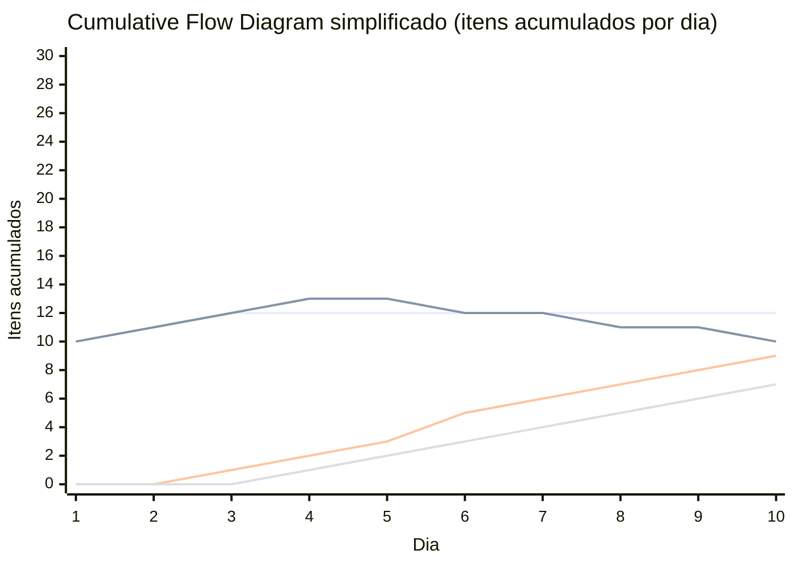

# Exercício 4 — Gargalo de fluxo na coluna "em revisão"

## Cumulative flow diagram hipotético (dez dias úteis)

O CFD abaixo mostra o acúmulo de itens por coluna ao longo de dez dias. A coluna "em revisão" cresce de forma desproporcional a partir do dia 4 e não esvazia, enquanto "em desenvolvimento" e "pronto" avançam em ritmo mais lento.

## Métricas de fila para "em revisão"

O tamanho da fila em "em revisão" subiu de 0 no dia 1 para 9 no dia 10, com crescimento médio de cerca de 1 item por dia a partir do dia 4. O tempo médio de espera na coluna, medido pela diferença entre entrada e saída de cada item, foi de 4,2 dias nos últimos cinco itens que passaram pela coluna, contra 1,3 dia nos dois primeiros. O tamanho da fila e o tempo de espera crescem juntos, o que é o padrão clássico de gargalo.

## Diagnóstico: capacidade insuficiente de revisores ou outro fator

O padrão do CFD indica capacidade insuficiente de revisores, e não outro fator, por três razões. Primeiro, a fila em "em revisão" cresce de forma monotônica, sem oscilação, o que é típico de chegada maior que capacidade de atendimento, e não de bloqueio pontual. Segundo, o tempo de espera aumenta ao longo do tempo, o que indica que a fila não é atendida na mesma velocidade em que se forma. Terceiro, a coluna "em desenvolvimento" não cresce, o que mostra que o problema não está na produção, está na etapa seguinte. Se fosse falta de refinamento ou dependência externa, a fila oscilaria e haveria itens bloqueados visíveis, o que não aparece no padrão descrito.

## Registro do diagnóstico para a retrospectiva

O diagnóstico deve ser registrado em uma ficha simples, com quatro campos: (1) sintoma, fila em "em revisão" crescendo de 0 para 9 em dez dias, com tempo de espera subindo de 1,3 para 4,2 dias; (2) evidência, CFD com crescimento monotônico da coluna e "em desenvolvimento" estável; (3) hipótese, capacidade de revisão insuficiente para o volume produzido; (4) próximo passo, testar uma melhoria de fluxo na próxima Sprint e comparar a fila antes e depois. Essa ficha é levada à retrospectiva como base para a discussão, sem prescrever a solução antes de o time analisar.
